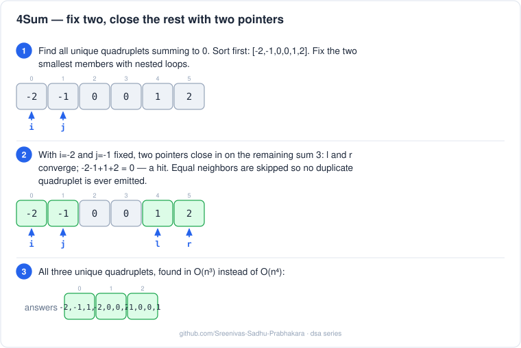

# 4Sum

> Striver SDE Sheet 020 · Day 4 Arrays — sort, fix two values in nested loops, close each pair with two pointers, skip duplicates at every level. Go, stdlib only, tested.

## Problem

Find every *unique* quadruplet of values in an array that sums to a target. Uniqueness is over values, not indices — `[2,2,2,2,2]` with target 8 yields exactly one quadruplet.

## Approach

Sort first; order is what makes both tricks work. Fix the two smallest members with nested loops, then the remaining pair-sum problem over a sorted range is solved with converging left/right pointers in linear time. Duplicate suppression happens at all four positions: outer loops skip repeated values, and after recording a hit both pointers skip past equal neighbors. Summing in 64-bit avoids overflow when four large 32-bit values combine.

**Complexity:** O(n³) time, O(1) extra space beyond the output.

## Visual walkthrough

Read the picture top to bottom — each numbered frame is one moment of the algorithm
running on this repo's test example.

## Run

    go test ./...   # verify
    go run .        # demo

---

One of 191 repos solving Striver's SDE Sheet in Go — stdlib only, one problem per repo, every solution tested. Browse the set: [`dsa-*` repos](https://github.com/Sreenivas-Sadhu-Prabhakara?tab=repositories&q=dsa-&type=source).
